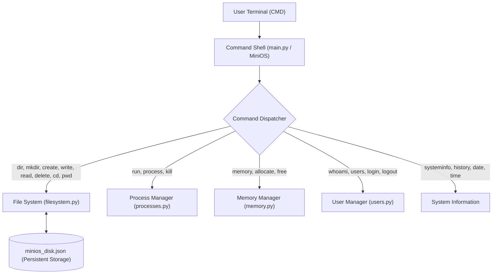
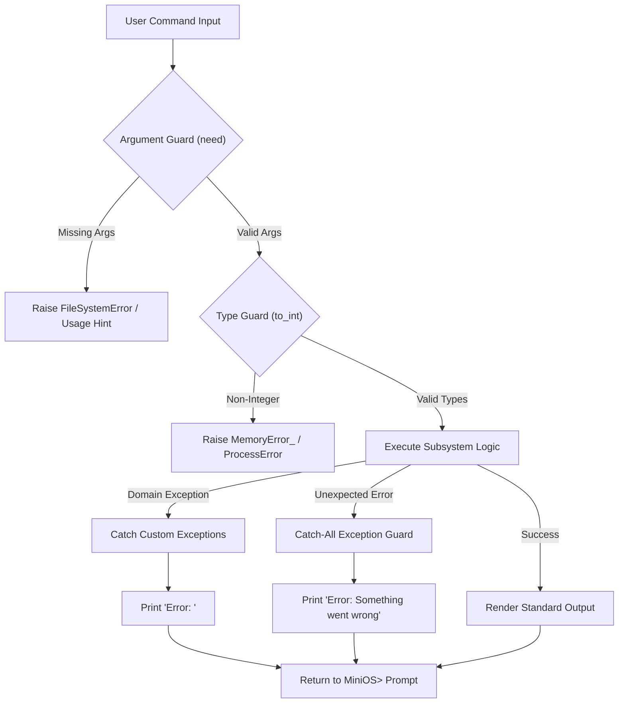

# MiniOS Alpha — Technical Documentation

**Operating System:** MiniOS Alpha v1.0  
**Project:** IT 3131 Final Project (Operating Systems Simulator)  
**Group:** Group 1 (MiniOS Alpha)

---

## Table of Contents

1. [1. Introduction](#1-introduction)
2. [2. Project Objectives](#2-project-objectives)
3. [3. System Architecture](#3-system-architecture)
4. [4. Program Structure](#4-program-structure)
5. [5. File Management Subsystem](#5-file-management-subsystem)
6. [6. Process Management Subsystem](#6-process-management-subsystem)
7. [7. Memory Management Subsystem](#7-memory-management-subsystem)
8. [8. User Management Subsystem](#8-user-management-subsystem)
9. [9. Error Handling Architecture](#9-error-handling-architecture)
10. [10. Testing & Verification](#10-testing--verification)
11. [11. Problems Encountered & Technical Solutions](#11-problems-encountered--technical-solutions)
12. [12. Conclusion](#12-conclusion)

---

## 1. Introduction

MiniOS Alpha is a modular command-line operating system simulator written in Python 3. Developed for the IT 3131 Operating Systems final project, it executes inside any standard command shell (with primary design targeting Windows Command Prompt / CMD) and simulates the major functional layers of an operating system without requiring real kernel privileges, low-level drivers, or bootable virtual machine images.

The simulator demonstrates five core operating systems concepts:

1. **Interactive Command Shell (CLI):** REPL architecture, token parsing, and history tracking.
2. **Hierarchical Virtual Filesystem:** In-memory tree structure with JSON disk persistence.
3. **Simulated Process Scheduling:** Process control table, sequential PID allocation, and state tracking.
4. **Simulated Memory Management:** Partitioned RAM model with kernel space and dynamic user allocation bounds.
5. **Role-Based User Security:** SHA-256 hashed credentials, terminal input masking, and attempt-limited authentication.

---

## 2. Project Objectives

The primary engineering objectives of MiniOS Alpha are:

- **Demonstrate OS Abstractions:** Model fundamental operating system abstractions (files, processes, memory blocks, and user security contexts) cleanly in high-level object-oriented code.
- **Portability & Zero External Dependencies:** Run out-of-the-box on standard Python 3 distributions using standard library modules only (`os`, `sys`, `time`, `datetime`, `json`, `hashlib`, `getpass`, `platform`).
- **Modularity & Separation of Concerns:** Encapsulate each major OS subsystem into its own dedicated module (`filesystem.py`, `processes.py`, `memory.py`, `users.py`) coordinated by an orchestration engine (`main.py`).
- **Defensive Resilience:** Ensure the command shell never crashes or raises unhandled tracebacks when invalid commands, malformed parameters, out-of-bounds memory requests, or missing files are encountered.
- **Persistent State Simulation:** Preserve virtual file and directory structures between simulator sessions using JSON serialization (`minios_disk.json`) while resetting volatile structures (processes and RAM allocations) to emulate a clean hardware reboot.

---

## 3. System Architecture

MiniOS Alpha employs a layered architectural design. The user communicates directly with the **Command Shell**, which parses user commands and dispatches requests through an internal routing table to the appropriate underlying OS subsystems.

### Component Architecture Diagram

```
                 MiniOS
                    |
             Command Shell (main.py)
                    |
       +------------+------------+
       |            |            |
  File System   Processes      Memory
 (filesystem.py)(processes.py)(memory.py)
       |
     Users (users.py)
       |
  System Info (main.py)
```

### Architectural Subsystem Responsibilities



1. **Presentation & Shell Layer (`main.py`):** Captures raw terminal input, formats display output, runs the REPL loop, and acts as the global exception barrier.
2. **File Management Subsystem (`filesystem.py`):** Maintains the virtual directory hierarchy, enforces path resolution and naming constraints, and synchronizes state to `minios_disk.json`.
3. **Process Management Subsystem (`processes.py`):** Maintains the active Process Table, manages sequential PID assignment, tracks execution status, and handles process termination.
4. **Memory Management Subsystem (`memory.py`):** Tracks fixed total virtual memory (1024 MB), enforces kernel memory protection (256 MB), and evaluates dynamic allocation/release boundaries.
5. **User Security Subsystem (`users.py`):** Manages user authentication, hashes passwords via SHA-256, enforces the 3-attempt lockout policy, and maintains active session identity.

---

## 4. Program Structure

The MiniOS Alpha codebase is organized into cleanly separated modules:

```
MiniOS/
├── main.py              # Shell REPL, command routing, system info, exception barrier
├── filesystem.py        # Hierarchical file system and persistence engine
├── processes.py         # Process manager, table, PID generator, lifecycle
├── memory.py            # Simulated RAM manager, kernel reserve, allocation logic
├── users.py             # User accounts, SHA-256 authentication, login prompts
├── minios_disk.json     # Serialized virtual filesystem storage
├── requirements.txt     # Runtime target and standard library dependencies
├── README.md            # Project overview, installation, and run instructions
├── docs/                # User Manual and Technical Documentation
├── screenshots/         # Terminal execution captures
└── individual-reports/  # Individual student contribution reports
```

### Module Responsibilities

| File                                                                                 | Primary Class / Functions        | Key Responsibility                                                                                                                                           |
| :----------------------------------------------------------------------------------- | :------------------------------- | :----------------------------------------------------------------------------------------------------------------------------------------------------------- |
| [`main.py`](file:///Users/matthew/Downloads/MiniOS_Alpha/MiniOS/main.py)             | `MiniOS`                         | Main entry point; controls startup banner, login loop, REPL prompt (`MiniOS>`), command dispatch dictionary, argument validation, and global error handling. |
| [`filesystem.py`](file:///Users/matthew/Downloads/MiniOS_Alpha/MiniOS/filesystem.py) | `FileSystem`, `FileSystemError`  | Implements in-memory directory tree, path normalization, file creation, editing, deletion, navigation, and disk serialization.                               |
| [`processes.py`](file:///Users/matthew/Downloads/MiniOS_Alpha/MiniOS/processes.py)   | `ProcessManager`, `ProcessError` | Maintains Process Table, assigns sequential PIDs (1 to N), tracks `RUNNING` status, enforces maximum process limit (10).                                     |
| [`memory.py`](file:///Users/matthew/Downloads/MiniOS_Alpha/MiniOS/memory.py)         | `MemoryManager`, `MemoryError_`  | Models 1024 MB total RAM, reserves 256 MB for the OS kernel, validates dynamic user allocations and releases.                                                |
| [`users.py`](file:///Users/matthew/Downloads/MiniOS_Alpha/MiniOS/users.py)           | `UserManager`, `_hash`           | Stores hashed user credentials, runs masked login prompts via `getpass`, tracks login attempts (max 3), and provides user identity.                          |

---

## 5. File Management Subsystem

The virtual file system simulates a hierarchical directory structure entirely in software.

### In-Memory Node Representation

Files and directories are modeled as nested Python dictionaries:

- **Directory Node:**
  ```python
  {"type": "dir", "children": {}}
  ```
- **File Node:**
  ```python
  {"type": "file", "content": "Hello World"}
  ```

### Path Resolution Engine (`_parts` and `_node`)

MiniOS Alpha supports both absolute paths (starting with `/` or `\`) and relative paths (relative to `self.cwd`):

- Normalizes Windows `\` and Unix `/` separators into unified tokens.
- Supports traversal operators:
  - `.` refers to the current directory.
  - `..` pops the current directory component, moving up to the parent directory.
- `_node(parts)` traverses the dictionary tree from `self.root`, verifying that every intermediate token is an existing directory.

### Name Validation (`_check_name`)

Filenames and directory names are restricted using a strict character blacklist matching real operating systems:

```python
INVALID_CHARS = set('/\\:*?"<>|')
```

Attempting to create an entity with any of these characters immediately raises `FileSystemError('Invalid name. Avoid / \\ : * ? " < > |')`.

### Persistence Mechanism (`_save` and `_load`)

To allow files to survive between program restarts without modifying real operating system files, MiniOS Alpha serializes `self.root` to `minios_disk.json`:

- **Save:** Triggered automatically after any mutating operation (`mkdir`, `create`, `write`, `delete`, `rename`).
- **Load:** Executed during `FileSystem.__init__()`. If `minios_disk.json` is missing or corrupted, a clean empty root directory is instantiated without crashing.

---

## 6. Process Management Subsystem

The process management subsystem simulates operating system multitasking and process control.

### Process Representation

Active processes are stored in an internal dictionary (`self._procs`), keyed by integer Process Identifier (PID):

```python
{
    "pid": 1,
    "name": "calculator",
    "status": "RUNNING",
    "started": "21:45:00"
}
```

### PID Allocation

- PIDs are monotonically increasing integers managed by `self._next_pid`.
- Starts at `1` upon simulator boot.
- PIDs are never reused during a single session, preventing stale PID references.

### Process Limits & Concurrency Constraints

- Maximum running processes is constrained: `MAX_PROCESSES = 10`.
- Calling `run` when `len(self._procs) >= 10` raises:
  `ProcessError("Process limit reached (10). Kill one first.")`.

### Process Termination (`kill`)

- Verifies that the requested PID exists in `self._procs`.
- If found, removes the record via `self._procs.pop(pid)` and returns the terminated process object.
- If not found, raises `ProcessError("Process does not exist.")`.

---

## 7. Memory Management Subsystem

MiniOS Alpha models computer RAM using a partitioned memory pool abstraction.

### Memory Layout

- **Total Simulated Memory (`TOTAL_MB`):** Fixed at `1024 MB`.
- **Kernel Reserved Memory (`OS_RESERVED_MB`):** Fixed at `256 MB`. This simulates memory permanently occupied by the OS kernel and system services.
- **User Allocated Memory (`self.allocated`):** Dynamically tracked user allocations (initialized to `0 MB`).
- **Used Memory (`used` property):** Computed as `OS_RESERVED_MB + self.allocated`.
- **Free Memory (`free_mb` property):** Computed as `TOTAL_MB - self.used` (starts at `768 MB`).

### Allocation Logic (`allocate(mb)`)

1. Validates that `mb > 0`; otherwise raises `MemoryError_("Amount must be a positive number.")`.
2. Validates that `mb <= self.free_mb`; otherwise raises:
   `MemoryError_(f"Not enough free memory. Only {self.free_mb} MB available.")`.
3. Increments `self.allocated += mb`.

### Release Logic (`release(mb)`)

1. Validates that `mb > 0`; otherwise raises `MemoryError_("Amount must be a positive number.")`.
2. Validates that `mb <= self.allocated`; otherwise raises:
   `MemoryError_(f"Cannot free {mb} MB. Only {self.allocated} MB is allocated by you.")`.
3. Decrements `self.allocated -= mb`.

---

## 8. User Management Subsystem

MiniOS Alpha incorporates a user security layer ensuring access control and session management.

### Credential Storage & Hashing

User passwords are never stored in plaintext. They are hashed using SHA-256 via Python's standard `hashlib` library:

```python
def _hash(password):
    return hashlib.sha256(password.encode("utf-8")).hexdigest()
```

The internal credential store initializes two default accounts:

- `admin`: SHA-256 digest of `"admin123"` (Role: `"Administrator"`).
- `student`: SHA-256 digest of `"student123"` (Role: `"Standard User"`).

### Terminal Masking (`getpass`)

During credential entry, MiniOS Alpha utilizes `getpass.getpass("Password: ")`. Keystrokes are not echoed to the terminal, preventing visual shoulder-surfing in CMD. A fallback to standard `input` is implemented if running under non-standard TTY environments.

### Brute-Force Safeguard (`MAX_ATTEMPTS = 3`)

The login loop tracks consecutive failed authentication attempts. If a user fails 3 times, `login_prompt()` returns `False`, causing the shell to terminate cleanly:

```
Too many failed attempts. Shutting down MiniOS...
```

---

## 9. Error Handling Architecture

MiniOS Alpha employs a multi-tiered defensive design to prevent unhandled exceptions from terminating the interactive shell.



### 1. Argument Count Validation (`need`)

Utility method ensuring mandatory parameters are present before invoking command logic:

```python
@staticmethod
def need(args, n, usage):
    if len(args) < n:
        raise FileSystemError(f"Missing argument. Usage: {usage}")
```

### 2. Type Conversion Validation (`to_int`)

Converts numeric command arguments safely without throwing uncaught `ValueError`:

```python
@staticmethod
def to_int(text, what):
    try:
        return int(text)
    except ValueError:
        raise MemoryError_(f"{what} must be a whole number.")
```

### 3. Domain-Specific Custom Exceptions

Subsystems raise distinct exceptions:

- `FileSystemError`
- `ProcessError`
- `MemoryError_`

### 4. Global Exception Barrier (`MiniOS.execute`)

The command dispatcher wraps handler execution in a comprehensive exception barrier:

```python
try:
    handler(args, line)
except FileSystemError as e:
    print(f"Error: {e}")
except ProcessError as e:
    print(f"Error: {e}")
except MemoryError_ as e:
    print(f"Error: {e}")
except Exception as e:
    print(f"Error: Something went wrong ({type(e).__name__}).")
```

This guarantees that unexpected runtime bugs never terminate the user's active session.

---

## 10. Testing & Verification

The MiniOS Alpha system was verified through automated unit tests, manual edge-case testing, and command execution verification.

### Automated Test Cases

| Test Category           | Target Module   | Verified Behavior                                                                          |  Result  |
| :---------------------- | :-------------- | :----------------------------------------------------------------------------------------- | :------: |
| **Filesystem Tree**     | `filesystem.py` | Directory creation, file writing, reading, and non-empty folder deletion rejection.        | **PASS** |
| **Process Lifecycle**   | `processes.py`  | PID assignment, process listing, termination, and non-existent PID rejection.              | **PASS** |
| **Memory Allocation**   | `memory.py`     | 1024 MB total, 256 MB base, dynamic allocation/release, and out-of-bounds rejection.       | **PASS** |
| **User Authentication** | `users.py`      | SHA-256 validation for `admin` and `student`, invalid password rejection, 3-attempt limit. | **PASS** |
| **Error Barrier**       | `main.py`       | Unknown commands, missing arguments, non-numeric PIDs, shell crash resistance.             | **PASS** |

### Stress & Boundary Test Verification

1. **Memory Ceiling:** Requesting 1000 MB when free memory is 768 MB correctly produces `Error: Not enough free memory. Only 768 MB available.` without corrupting memory states.
2. **Process Ceiling:** Spawning 11 processes triggers `Error: Process limit reached (10). Kill one first.` on the 11th call.
3. **Invalid Character Protection:** Attempting `create test:file` produces `Error: Invalid name. Avoid / \ : * ? " < > |`.
4. **Shell Crash Resistance:** Supplying malformed strings, arbitrary symbols, and empty newlines maintains the `MiniOS>` shell loop uninterrupted.

---

## 11. Problems Encountered & Technical Solutions

During development, several engineering challenges were identified and resolved:

### 1. Cross-Platform Command Compatibility (`cls` vs `clear`)

- **Problem:** Clearing the console requires `cls` on Windows Command Prompt, but `clear` on Unix/macOS terminals.
- **Solution:** Implemented platform-aware detection in `cmd_clear`:
  ```python
  os.system("cls" if os.name == "nt" else "clear")
  ```
  Both `clear` and `cls` are mapped in the command dictionary as valid aliases.

### 2. Path Separator Incompatibilities

- **Problem:** Windows uses backslashes (`\`) for directory paths while Unix uses forward slashes (`/`). Users might type either in CMD.
- **Solution:** In `filesystem._parts()`, all backslashes are normalized to forward slashes before splitting:
  ```python
  path.replace("\\", "/").split("/")
  ```
  This ensures seamless navigation regardless of which slash convention the user enters.

### 3. Disk State Corruption Prevention

- **Problem:** If a program crash or power loss occurred during file operations, saving real OS files could corrupt the project directory.
- **Solution:** Restricted all filesystem operations to a virtual dictionary tree isolated in a single JSON file (`minios_disk.json`). Wrapped disk I/O in exception suppression so disk write errors never abort command execution.

### 4. Non-TTY Password Input Handling

- **Problem:** `getpass.getpass()` raises exceptions in automated test environments or piped stdin without a real TTY.
- **Solution:** Wrapped `getpass` in a `try...except` block with fallback to standard `input("Password: ")`, ensuring automated scripts and standard terminals are both supported.

---

## 12. Conclusion

MiniOS Alpha demonstrates that complex operating system concepts—such as shell command dispatching, virtual filesystem management, process scheduling, dynamic memory tracking, and user access control—can be effectively modeled in a modular, high-level programming language.

By adhering strictly to the Python standard library, enforcing clean separation of concerns, and utilizing defense-in-depth error handling, the system delivers an educational simulator that is portable, robust, and reliable for student learning and academic evaluation.
